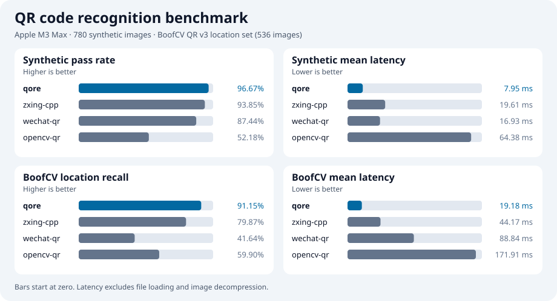

# qore

[English](README.md) · [简体中文](README.zh-CN.md) · 日本語

qore は、高速で外部依存のない Go 製 QR コードリーダーです。画像内の複数の QR コードを検出・デコードし、ペイロードと四隅の座標を返します。ライブラリと CLI は Go の標準ライブラリだけを使用し、cgo、OpenCV、モデルファイルは不要です。

## ダウンロードと SDK

| プラットフォーム | ダウンロード | バージョン |
| --- | --- | --- |
| Go とデスクトップ CLI | [qore リリース](https://github.com/firesh/qcore/releases/tag/v1.0.0) | v1.0.0 |
| Android と iOS | [モバイル SDK](https://github.com/firesh/qcore-mobile/releases/tag/v1.0.0) | v1.0.0 · コア v1.0.0 |

Flutter と React Native はネイティブ SDK を利用する予定です。WeChat ミニプログラムは実行環境の検証が必要です。

## クイックスタート

ローカルのチェックアウトで Go 1.23.6 以降を使って実行します。

```sh
go run ./cmd/qore --json image.png
go run ./cmd/qore --multi=false image.jpg
go test ./...
```

CLI は PNG、JPEG、GIF に対応し、ディレクトリを再帰的に走査できます。`--batch-stdin --json` を指定すると、1 行につき 1 つの画像パスを受け取り、結果を JSON で 1 行ずつ出力します。

Go API は `image.Image` を受け取ります。1 件の読み取りには `qore.Decode(img, nil)`、複数件には `qore.DecodeAll(img, nil)` を使います。`qore.DecodeFile(path, nil)` は JPEG の EXIF 方向を適用し、`qore.DecodeRawFile(path, nil)` は元のピクセル座標を保持します。

## ベンチマーク



| データセット | qore | ZXing-C++ |
| --- | ---: | ---: |
| 合成画像で期待する全ペイロードを取得 | 754/780（96.67%） | 732/780（93.85%） |
| BoofCV QR v3 の位置検出再現率 | 1123/1232（91.15%） | 984/1232（79.87%） |

Apple M3 Max での平均処理時間は、合成画像で **7.95 ms/枚**、BoofCV の位置検出セットで **19.18 ms/枚**でした。ファイルの読み込みと画像の展開は計測対象外です。

平均処理時間、評価方法、データセット別の結果は[比較レポート](benchmark/results/comparison_summary.md)にあります。[合成画像の HTML レポート](https://firesh.github.io/qcore/benchmark/)ではシナリオ別の結果と失敗画像を確認できます。依存関係とコマンドは[再現手順](benchmark/README.md)を参照してください。

## ライセンス

qore は [MIT ライセンス](LICENSE)で提供されます。同梱の合成ベンチマークには個別の [Apache-2.0 ライセンス](benchmark/synthetic/LICENSE)が適用されます。
