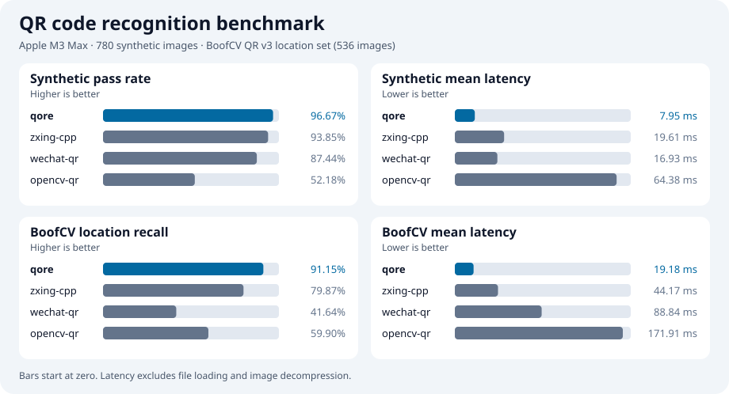

# qore

English · [简体中文](README.zh-CN.md) · [日本語](README.ja.md)

qore is a fast, dependency-free QR code reader for Go. It detects and decodes multiple QR codes from an image and returns their payloads and corner coordinates. The Go library and CLI use the standard library, with no cgo, OpenCV, or model files.

## Downloads and SDKs

| Platform | Package | Version |
| --- | --- | --- |
| Go and desktop CLI | [qore release](https://github.com/firesh/qcore/releases/tag/v1.0.0) | v1.0.0 |
| Android and iOS | [Mobile SDK](https://github.com/firesh/qcore-mobile/releases/tag/v1.0.0) | v1.0.0 · core v1.0.0 |

Flutter and React Native are planned to use the native SDK. WeChat Mini Program support is pending runtime validation.

## Quick start

From a local checkout, with Go 1.23.6 or later:

```sh
go run ./cmd/qore --json image.png
go run ./cmd/qore --multi=false image.jpg
go test ./...
```

The CLI accepts PNG, JPEG, and GIF images, and can scan directories recursively. Use `--batch-stdin --json` to pass one path per line and receive one JSON result per line.

In Go, call `qore.Decode(img, nil)` for one QR code or `qore.DecodeAll(img, nil)` for multiple codes. Both accept an `image.Image`. Use `qore.DecodeFile(path, nil)` to decode a file and apply JPEG EXIF orientation, or `qore.DecodeRawFile(path, nil)` to keep the original pixel coordinates.

## Benchmarks



| Dataset | qore | ZXing-C++ |
| --- | ---: | ---: |
| Synthetic images, all expected payloads recovered | 754/780 (96.67%) | 732/780 (93.85%) |
| BoofCV QR v3, location recall | 1123/1232 (91.15%) | 984/1232 (79.87%) |

On the Apple M3 Max benchmark machine, qore averaged **7.95 ms/image** on the synthetic set and **19.18 ms/image** on the BoofCV location set. Timings exclude file loading and image decompression.

See the [four-engine benchmark](benchmark/results/comparison_summary.md) for mean latency, scoring, and results by dataset. The [synthetic HTML report](https://firesh.github.io/qcore/benchmark/) includes per-scenario results and failure images. [Reproduction instructions](benchmark/README.md) list the dependencies and commands.

## License

qore is licensed under the [MIT License](LICENSE). The bundled synthetic benchmark is licensed separately under [Apache-2.0](benchmark/synthetic/LICENSE).
