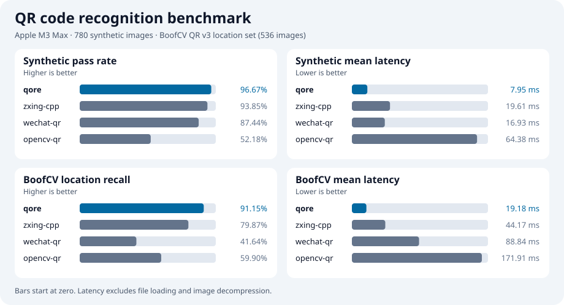

# qore

[English](README.md) · 简体中文 · [日本語](README.ja.md)

qore 是一个快速、零第三方依赖的 Go 二维码读取库。它可以在一张图里定位并解码多个二维码，返回载荷和四角坐标。Go 库和 CLI 只使用标准库，无需 cgo、OpenCV 或模型文件。

## 下载与 SDK

| 平台 | 下载 | 版本 |
| --- | --- | --- |
| Go 与桌面 CLI | [qore 发布页](https://github.com/firesh/qcore/releases/tag/v1.0.0) | v1.0.0 |
| Android 与 iOS | [移动 SDK](https://github.com/firesh/qcore-mobile/releases/tag/v1.0.0) | v1.0.0 · 核心 v1.0.0 |

Flutter 和 React Native 计划复用原生 SDK。微信小程序待验证运行方案。

## 快速开始

在本地检出目录中使用 Go 1.23.6 或更高版本运行。

```sh
go run ./cmd/qore --json image.png
go run ./cmd/qore --multi=false image.jpg
go test ./...
```

CLI 支持 PNG、JPEG 和 GIF，也可以递归扫描目录。使用 `--batch-stdin --json` 可逐行传入文件路径，并逐行获取 JSON 结果。

Go API 接收 `image.Image`。用 `qore.Decode(img, nil)` 读取单个码，用 `qore.DecodeAll(img, nil)` 读取多个码。文件入口 `qore.DecodeFile(path, nil)` 会应用 JPEG EXIF 方向，`qore.DecodeRawFile(path, nil)` 保留原始像素坐标。

## 基准结果



| 数据集 | qore | ZXing-C++ |
| --- | ---: | ---: |
| 合成图，读出全部预期载荷 | 754/780（96.67%） | 732/780（93.85%） |
| BoofCV QR v3 定位召回率 | 1123/1232（91.15%） | 984/1232（79.87%） |

在 Apple M3 Max 上，qore 的合成集平均耗时为 **7.95 ms/图**，BoofCV 定位集为 **19.18 ms/图**。计时不含文件读取和图片解压。

[四库对照报告](benchmark/results/comparison_summary.md)列出了平均耗时、评分口径和分数据集结果。[合成集 HTML 报告](https://firesh.github.io/qcore/benchmark/)提供场景明细和失败图。[复测说明](benchmark/README.md)列出了依赖和命令。

## 许可证

qore 采用 [MIT 许可证](LICENSE)。随仓库提供的合成基准采用独立的 [Apache-2.0 许可证](benchmark/synthetic/LICENSE)。
